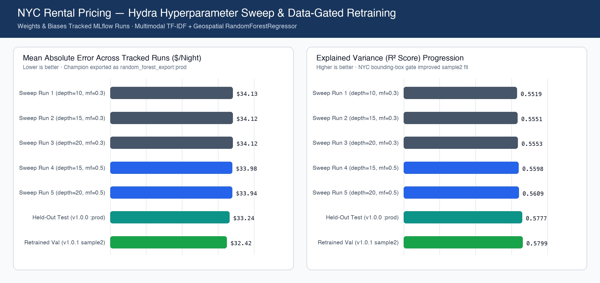
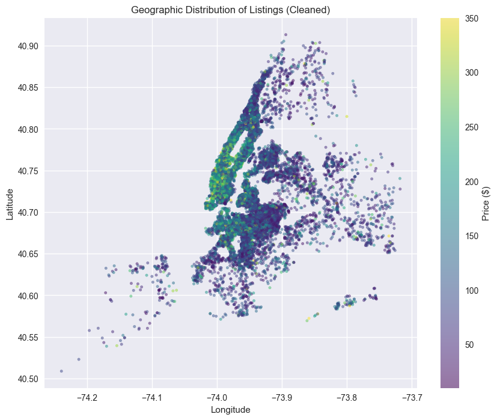
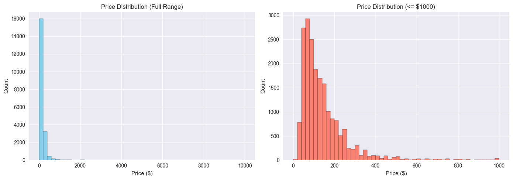
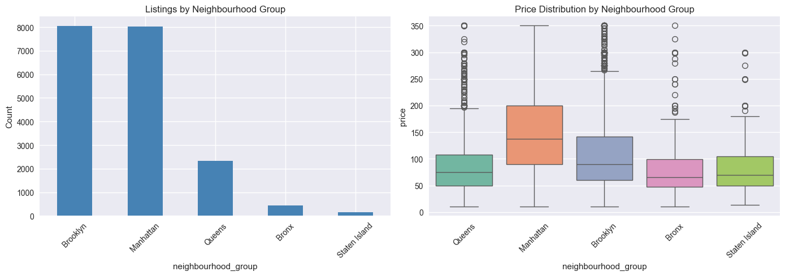
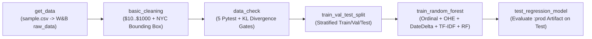

# Reproducible NYC Short-Term Rental Pricing Pipeline (MLflow + Hydra + W&B)


End-to-end reproducible machine learning workflow for predicting nightly short-term rental prices across New York City's five boroughs (`$10–$1,000/night`). Orchestrated as a multi-environment **MLflow Project** parameterized with **Hydra** (`-m` grid sweeps), tracked end-to-end with **Weights & Biases** data/model lineage, and guarded by automated **Pytest + SciPy KL-divergence** statistical data contracts.

---

## 1. Hydra Sweep, Held-Out Test & Data-Gate Retraining Benchmarks



| W&B Run ID | Pipeline Stage / Experiment | Split | MAE (`$/night`) | $R^2$ Score | Status |
| :--- | :--- | :---: | :---: | :---: | :--- |
| `rhbtd3xn` | Hydra Sweep (`max_depth=10, max_features=0.3`) | Val | `$34.13` | `0.5519` | Logged |
| `d6iy3dld` | Hydra Sweep (`max_depth=20, max_features=0.3`) | Val | `$34.12` | `0.5553` | Logged |
| `ytbddfad` | Hydra Sweep (`max_depth=15, max_features=0.5`) | Val | `$33.98` | `0.5609` | Logged |
| `k5w553gw` | Hydra Sweep Champion (`max_depth=20, max_features=0.5`) | Val | `$33.94` | `0.5598` | Promoted `:prod` |
| **`j96yazwl`** | **`test_regression_model` (`v1.0.0` Champion)** | **Test** | **`$33.24`** | **`0.5777`** | **Verified Release `v1.0.0`** |
| — | `data_check` on `sample2.csv` (Pre-Fix) | Gate | *Blocked* | — | Caught corrupted GPS rows outside NYC |
| **`j3h6yvra`** | **Retrained `sample2.csv` (`v1.0.1` Geo-Bounded)** | **Val** | **`$32.42`** | **`0.5799`** | **Verified Release `v1.0.1`** |

Full run telemetry is archived in [`reports/wandb_evaluation_summary.json`](reports/wandb_evaluation_summary.json).

---

## 2. Exploratory Spatial & Distribution Analysis (`EDA.ipynb`)

### Geospatial Price Topology Across NYC Boroughs & Random Forest Feature Importances
| NYC Geospatial Listing Price Map | Exported Multimodal Feature Importances |
| :---: | :---: |
|  |  |

### Nightly Price Tail Filtering & Borough × Room-Type Segmentation



---

## 3. Reproducible Multi-Step MLflow DAG & Data Contracts



### Automated `src/data_check/` Pytest Contract Suite
1. **`test_column_names`** — Enforces exact 16-column schema order and types.
2. **`test_neighborhood_names`** — Verifies strict membership in `{Bronx, Brooklyn, Manhattan, Queens, Staten Island}`.
3. **`test_proper_boundaries`** — Asserts `longitude ∈ [-74.25, -73.50]` and `latitude ∈ [40.50, 41.20]` (caught corrupted coordinates in `sample2.csv` prior to training).
4. **`test_similar_neigh_distrib`** — Computes discrete **Kullback-Leibler divergence** (`scipy.stats.entropy`) against reference artifact `clean_sample:reference` enforcing `KL < 0.20`.
5. **`test_row_count`** — Enforces `15,000 < n_rows < 100,000`.

---

## 4. Quick Start & Hydra Multi-Run Execution

```bash
conda env create -f environment.yml
conda activate nyc_airbnb_dev
wandb login

# Run full end-to-end training & validation DAG
mlflow run .

# Launch Hydra multi-run hyperparameter grid sweep
mlflow run .   -P hydra_options="rf_pipeline.random_forest.max_depth=10,15,20 rf_pipeline.random_forest.max_features=0.3,0.5 -m"

# Evaluate promoted production artifact on held-out test split
mlflow run .   -P steps=test_regression_model   -P hydra_options="main.execute_steps=['test_regression_model']"
```

## License

MIT License — see [LICENSE](LICENSE).
