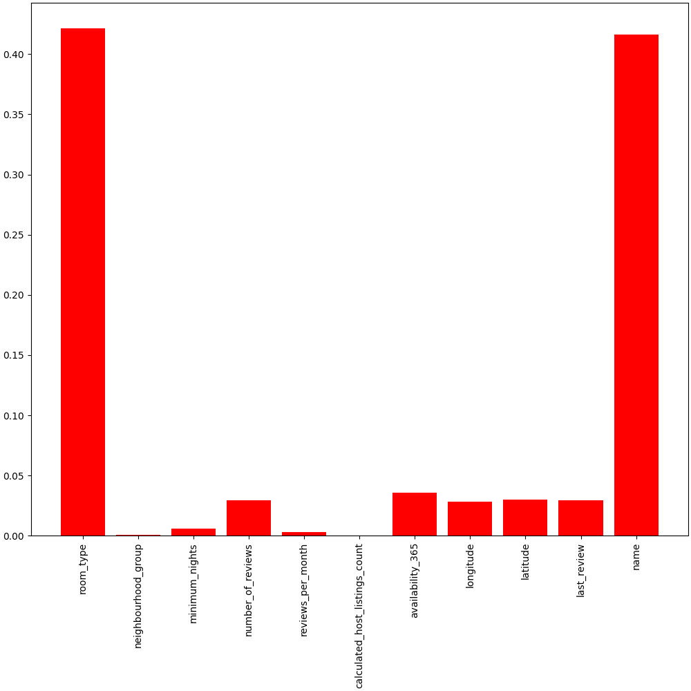
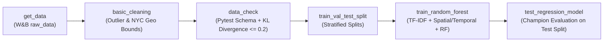

# Reproducible NYC Short-Term Rental Pricing Pipeline (MLflow + Hydra + W&B)

End-to-end reproducible machine learning workflow for predicting nightly short-term rental prices across New York City's five boroughs, orchestrated via **MLflow Projects**, **Hydra** hierarchical configuration & multi-run hyperparameter sweeps, **Weights & Biases** artifact lineage tracking, and **Pytest + SciPy KL-divergence** automated data validation gates.

---

## Pipeline Performance & Data Gate Validation

| Evaluation Stage | Dataset / Artifact | Mean Absolute Error (MAE) | $R^2$ Score | Notes |
| :--- | :--- | :---: | :---: | :--- |
| **Production Model (`v1.0.0`)** | Held-out `test_data.csv` | **`$33.24` / night** | **`0.5777`** | Multimodal `RandomForestRegressor` + TF-IDF pipeline |
| **Data Gate Catch (`sample2.csv`)** | Pre-split `data_check` | *Halted cleanly* | — | `test_proper_boundaries` caught out-of-box GPS rows |
| **Retrained Release (`v1.0.1`)** | `sample2.csv` Validation | **`$32.42` / night** | **`0.5799`** | Enforced NYC bounding box `[-74.25..-73.50, 40.5..41.2]` |



---

## Multi-Step MLflow DAG



- **Multimodal Preprocessing (`src/train_random_forest/`)**: `ColumnTransformer` combining `OrdinalEncoder` (`room_type`), `OneHotEncoder` (`neighbourhood_group`), `SimpleImputer` + date-delta `FunctionTransformer` (`last_review`), `TfidfVectorizer` (`name` free-text listing title), and `RandomForestRegressor`.
- **Statistical & Schema Data Tests (`src/data_check/`)**: Enforces column schema invariants, price bounds (`$10`–`$1,000`), NYC borough names, coordinate bounding boxes, and non-parametric SciPy KL-divergence (`kl_threshold = 0.2`) against reference distribution artifacts.

---

## Repository Structure

```text
nyc-rental-pricing-mlflow-pipeline/
├── MLproject                    # Root MLflow orchestrator entrypoints
├── main.py                      # Hydra-configured pipeline runner & step dispatcher
├── config.yaml                  # Centralized data, validation, and RF hyperparameters
├── EDA.ipynb                    # Exploratory analysis notebook
├── src/
│   ├── basic_cleaning/          # Geospatial & price outlier filtering component
│   ├── data_check/              # Pytest + KL-divergence data contract suite
│   ├── eda/                     # Profiling step
│   └── train_random_forest/     # Multimodal sklearn pipeline trainer & W&B exporter
├── components/
│   ├── get_data/                # Artifact ingestion component
│   ├── train_val_test_split/    # Deterministic dataset splitter
│   ├── test_regression_model/   # Held-out test evaluator against :prod model
│   └── wandb_utils/             # Shared artifact logging utilities
└── images/
    └── feature_importance.png   # Exported Random Forest feature importances
```

---

## Quick Start

```bash
conda env create -f environment.yml
conda activate nyc_airbnb_dev
wandb login

# Execute full training & validation DAG
mlflow run .

# Run Hydra multi-run hyperparameter sweep
mlflow run .   -P hydra_options="rf_pipeline.random_forest.max_depth=10,15,20 rf_pipeline.random_forest.max_features=0.3,0.5 -m"

# Evaluate champion production artifact on held-out test split
mlflow run . -P steps=test_regression_model
```

## License

MIT License — see [LICENSE](LICENSE).
